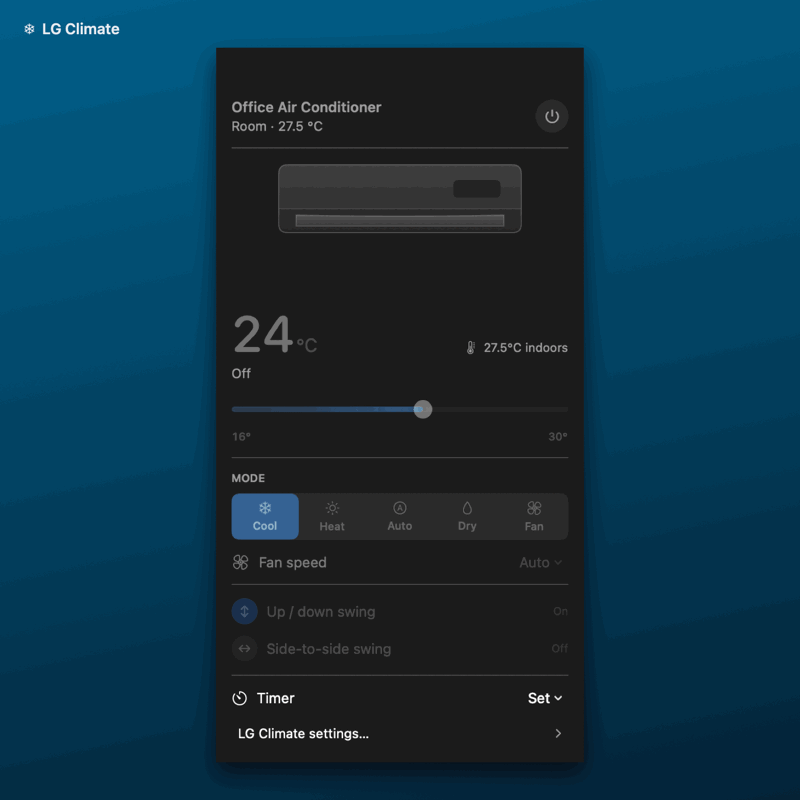

<div align="center">

# LG Climate

**Control LG ThinQ air conditioners from the macOS menu bar.**


</div>

<div align="center">
  
</div>

LG Climate is a native SwiftUI menu-bar controller for LG ThinQ air
conditioners. It connects directly to LG ThinQ Connect, discovers each unit's
capabilities at runtime, and keeps the Personal Access Token in macOS Keychain.
There is no intermediary project server, analytics service, or background daemon.

## Features

- Power, target temperature, operating mode, and fan speed
- Jet mode through a reported turbo control or `POWER` fan speed
- Energy control through LG's reported power-save capability
- Current room temperature in the panel and menu bar
- Vertical and horizontal swing when supported by the unit
- One-shot start and stop timers
- Multiple-unit switching
- Animated wall unit with mode-aware airflow, fan speed, and louver movement
- Half-degree temperature control when reported by the device
- Optimistic controls followed by confirmation from LG's reported state
- State-only background sync so changes made with the physical remote appear promptly
- Capability-driven UI instead of a hard-coded model profile
- Universal Apple silicon and Intel builds

Jet and Energy Control availability varies by model and region. LG Climate enables
each control only when the air conditioner's ThinQ profile reports a compatible
writable property; otherwise the row is labelled **Unavailable**. The public API
commonly exposes Energy Control as an on/off power-saving mode rather than the
remote control's 80% / 60% / 40% steps.

## Requirements

- macOS 14 Sonoma or later
- An LG air conditioner already paired in the LG ThinQ mobile app
- An LG ThinQ Connect Personal Access Token with device scopes
- Internet access

## Install

Download the latest ZIP from the repository's Releases page, unzip it, and move
**LG Climate.app** to Applications.

The project currently produces locally signed builds rather than Apple-notarized
releases. On first launch, Control-click the app, choose **Open**, then confirm.

Click the snowflake in the menu bar and enter:

1. A Personal Access Token from [LG ThinQ Connect](https://connect-pat.lgthinq.com).
2. The two-letter country code registered to the LG account, such as `ZA`, `US`,
   or `GB`. This is the account country, which may differ from your current location.

The token must include device permissions. It is saved in the macOS Keychain when
**Remember in Keychain** is enabled.

## Build from source

The project is a Swift Package and does not require an Xcode project.

```sh
swift test
./Scripts/build-app.sh
```

The build script creates a universal Apple silicon and Intel application, closes
any running LG Climate instance, and launches the new build. To build without
launching it, run `LGCLIMATE_LAUNCH_AFTER_BUILD=0 ./Scripts/build-app.sh`.

To use a stable signing identity:

```sh
export LGCLIMATE_CODESIGN_IDENTITY="Developer ID Application: Your Name"
./Scripts/build-app.sh
```

Without that variable, the script uses ad-hoc signing. Rebuilding an ad-hoc signed
copy may cause macOS Keychain to request permission again.

## Architecture

```text
LG Climate.app ──HTTPS──► api-{region}.lgthinq.com
       │
       └── Personal Access Token in macOS Keychain
```

The app requests the device list, capability profile, and current state from LG.
Controls are rendered only when the selected unit reports them as writable. State
refreshes conservatively to avoid unnecessary requests, and each command is checked
against a subsequent device-state response.

LG error `1222` means the device is not connected. The unit remains visible, but
its controls stay disabled until it reconnects.

## Privacy and security

- The Personal Access Token is never written to a project file.
- With Keychain storage enabled, the token is stored only on the Mac.
- The app sends the token only to the selected regional LG ThinQ API.
- There are no analytics or project-operated servers.
- Never include tokens, device identifiers, or unredacted responses in bug reports.

## Credits

The menu-bar interaction and animated appliance presentation draw inspiration
from [TCLimate](https://github.com/umarz317/TCLimate) by Umar Afzal and
[Celsius](https://github.com/gbvillarinho/celsius) by Gabriel Villarinho.
LG ThinQ Connect protocol and capability work was adapted from
[lg-ac](https://github.com/mendelB/lg-ac) by Mendel Blesofsky.

See [THIRD_PARTY_NOTICES.md](THIRD_PARTY_NOTICES.md) for copyright and license
notices.

## License

LG Climate is available under the [MIT License](LICENSE).

Not affiliated with, endorsed by, or sponsored by LG Electronics. "LG" and
"ThinQ" are trademarks of their respective owners.
